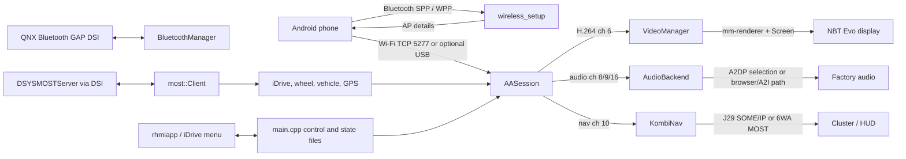

# NBT-AAD Architecture

## Component map

`milestone-7/src/main.cpp` is the QNX daemon entry point and subsystem coordinator. `milestone-7/rhmiapp/nbt_aad_app.cpp` is the native iDrive application used for launch, settings, screen handoff, and autostart. `milestone-7/plugin/` contains a separate HMI plugin integration. The Makefile produces `nbt-aad`, probes, plugin artifacts, and `rhmiapp/libNbtAad.so`.

## Android Auto boundary

`tcp_server.*` accepts the phone connection after wireless setup; `usb_accessory.*` and `usb_direct.*` provide the optional USB path. `session_owner.hpp` prevents simultaneous transport ownership. `aa_session.*` handles Android Auto framing, channel lifecycle, service discovery, control messages, sensors, audio/video delivery, media metadata, and navigation callbacks. `aa_cryptor.*` performs the TLS 1.2 handshake using the target's OpenSSL-compatible interface. `sdr_builder.*`, `aa_manifest.hpp`, and `proto/` define the advertised services and messages.

## QNX and BMW interfaces

- **Bluetooth:** `bluetooth_manager.cpp` opens DSI `SGBluetoothGap`/role `BSS_GAP`, registers the Android Auto SPP UUID, observes optional diagnostics, and performs bounded re-registration. Payload layouts are documented as reverse-engineered or inferred in code; retain those qualifiers.
- **MOST:** `most::Client` opens `DSYSMOSTServer`/`MOSTSubSystem` 4.5 through `DsiClient`. A router/reassembler feeds `car::CcsInput`, volume/input activity, GPS, vehicle sensors, tracing, and the 6WA HUDTerminal driver.
- **Controls:** `car/ccs_input.*` translates center-controller and voice events to callbacks in `main.cpp`; touch is read/forwarded by `touch_probe.*`. Media-wheel handling and back-hold behavior live in `main.cpp`.
- **Video:** `video_manager.*` uses QNX Screen and `mm-renderer` for H.264 presentation and cooperates with the RHMI app so factory UI and camera views can take priority.
- **Audio:** `src/audio/` provides Bluetooth, browser, and legacy A2I backends. Runtime routing may invoke the target's `audioconn` utility; some mappings are explicitly inferred in source comments.
- **Startup and state:** RHMI autostart uses persistent flags under `/var/opt/aa`; transient state and logs use `/dev/shmem`. Installation and rollback procedures are in root `install.md` and `updating.md`.

## Navigation and display integration

`AASession` sends channel-10 payloads to `KombiNav`. `cluster/nav_msg.hpp` decodes guidance; `cluster/nav_core.*` applies timing, stale-route, reroute, and factory-navigation yield policy. `J29Display` writes a J29 route graph over SOME/IP. `Hud6waDisplay` uses MOST HUDTerminal with a fixed 6WA profile and can run shadow/log-only. These are source-confirmed implementations, not proof of G30 compatibility. A G30 driver must begin with read-only discovery and a profile-specific fake/replay suite.

## External and proprietary dependencies

The target build requires QNX SDP 6.5.0/qcc and shipped target libraries including Screen, OpenSSL, socket/USB, and `liba2i_client`. Runtime paths also use BMW/QNX services and tools such as DSI brokers, MOST, LayerManagerControl, `mm-renderer`, `audioconn`, PPS, and head-unit configuration files. Their availability and behavior vary by firmware. Vendored SpeexDSP code is under `third_party/speexdsp/`.

## Evidence boundaries and history

Comments record car captures, static reverse engineering, experiments, and inference. A source implementation is **VERIFIED IN SOURCE**; target behavior requires a named vehicle/firmware test. Current Git configuration has only the fork `origin`; no upstream remote/ref exists, so a complete current-tree comparison with Sq00ky upstream is unavailable. Local history shows commit `4ff2d99` consolidated milestone history into `milestone-7` and later commits added extensive MOST, vehicle, cluster, audio, USB, and lifecycle work, but authorship or fork exclusivity must be determined commit by commit.
